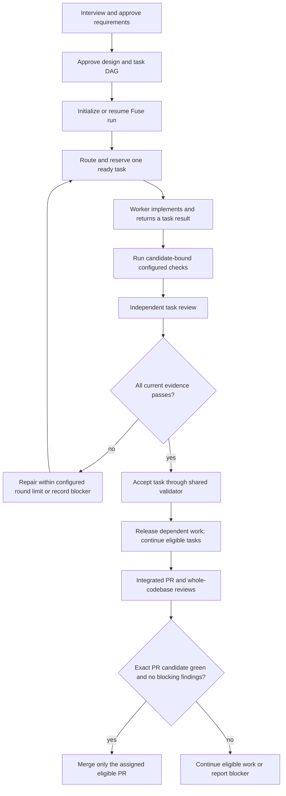

# Fuse user guide

Fuse combines spec-driven planning with the engineering methods selected from Poteto Mode. It is a Codex-first plugin: the `spec-execute` session coordinates one managed spec, while the CLI and run record enforce mechanical transitions and capture evidence. There is no always-on service or separate Orbit task board.

## Install and initialize

1. Install or open this repository as the Fuse plugin in Codex. Keep its absolute checkout path available; the `fuse_launch.py` wrapper invokes the plugin's locked environment from that checkout.
2. In the consuming repository, use Python 3.11 or newer and the repository's selected package manager. This implementation currently supports Python with `uv`; it reuses the existing manifest and lockfile and does not add dependencies to the consumer project.
3. Create or review a spec under `.specs/<id>-<slug>/`. A complete implementation spec contains `requirements.md` (or `bugfix.md`), `design.md`, and `tasks.md`. Run the traceability and task planner checks before managed execution.
4. Initialize one project configuration, then review its defaults:

   ```sh
   PLUGIN_ROOT=/absolute/path/to/fuse-spec
   REPO_ROOT="$PWD"
   uv run --project "$PLUGIN_ROOT" --directory "$PLUGIN_ROOT" --locked \
     python "$PLUGIN_ROOT/skills/scripts/fuse_config.py" init "$REPO_ROOT"
   uv run --project "$PLUGIN_ROOT" --directory "$PLUGIN_ROOT" --locked \
     python "$PLUGIN_ROOT/skills/scripts/fuse_config.py" \
     validate "$REPO_ROOT/.fuse/config.toml"
   ```

   These commands run the config script and locked environment from the absolute plugin checkout while passing the consuming repository root and config path explicitly. Initialization creates `.fuse/config.toml` only when its declared Python and uv setup matches files already in the repository. It does not install tools or rewrite package files. For a different stack, assess and provide a compatible config template; do not copy this Python template into that project.

5. Start a managed run through the launcher. Resolve `<plugin-root>` and `<repo-root>` to absolute paths; the spec path may be absolute or relative to the repository root:

   ```sh
   python3 <plugin-root>/skills/scripts/fuse_launch.py \
     --repo-root <repo-root> \
     --spec-dir .specs/001-example \
     initialize
   ```

The launcher resolves repository/spec paths before switching to the plugin directory. Managed operations must keep passing both absolute paths explicitly so Git and project checks run against the consumer repository.

## One source for check policy

`.fuse/config.toml` defines role profiles, required tools, unavailable behavior, repair/concurrency limits, check execution limits, toolchain selection, and every check's command, prerequisites, candidate inputs, and pass condition. `[limits.checks]` sets one shared timeout and retained-output cap per stream for every configured check. Both are positive-integer policy values and may be adjusted through the configured override policy; the config file is the source for their current values and defaults. `schemas/project-config.schema.json` validates the shape; `fuse_config.py` validates the relationships. The check graph uses Python's standard-library `graphlib` after Fuse checks IDs, references, and cycles. A configured argv item can include `{spec_dir}`; the check runner replaces it with the selected spec's repository-relative path in the pinned candidate worktree. Commands run from that candidate's repository root.

Run all configured checks locally with the same project-owned entry point that CI calls:

```sh
uv sync --locked
uv run --locked python skills/scripts/fuse_verify.py \
  --repo-root "$PWD" \
  --spec-dir "$PWD/.specs/001-example"
```

The runner reads `.fuse/config.toml`, validates the approved spec, captures a candidate identity, and executes configured checks in stable DAG order in pinned worktrees. Independent checks continue when another check fails; checks downstream of a non-passing prerequisite are reported as blocked. To run one check and all its transitive prerequisites, add `--check-id <id>`; repeat the flag for multiple selected checks. The JSON result has one entry per selected check, its outcome, summary, evidence identifier when captured, and blocker IDs. Output logs are saved under `.fuse/runs/<run-id>/artifacts/checks/`.

The run ID for this one-shot command is used only to group output artifacts. It does not create or update a canonical managed `run.json`. For lifecycle operations, use the `fuse_launch.py` CLI, which stores current check and review evidence in the managed run record.

### Local checks and GitHub Actions

`.github/workflows/verify.yml` handles triggers, read-only checkout permission, Python/uv setup, cache, and artifact upload. It invokes `fuse_verify.py` once, just like the local command. It listens to push, pull request, merge queue `merge_group`, and manual workflow dispatch events. It does not carry a second check list or dependency graph. Action versions are pinned to full commit SHAs. The workflow has no project-specific job timeout; GitHub Actions runner time and usage caps are platform settings, separate from Fuse's configurable model, review, and concurrency budgets.

CI status and its uploaded artifacts are remote evidence. A local pass does not prove CI passed, and an absent CI run is unverified. CI does not update the managed run record or accept a task by itself; Fuse still checks the current candidate, required checks, and independent reviews when accepting work.

## Planning, routes, and worker roles

The manager is the `spec-execute` session. It reads the approved task graph and run record, selects one implementation route before dispatch, then starts the worker with the task scope and evidence contract. `skills/poteto-mode/routes.json` is the only route catalog:

| Method | Use it when | Additional condition |
| --- | --- | --- |
| Feature | The task adds approved behavior or capability. | None |
| Bug Fix | Existing behavior violates an approved requirement or documented expectation. | Preserve the failure evidence and regression test. |
| Refactoring | The task changes structure while preserving observable behavior. | Keep behavior-preservation checks relevant. |
| Performance Issue | The approved task states a measurable performance goal. | Record comparable baseline and post-change measurements. |
| Runtime/Trace Forensics | The task diagnoses a live process or an existing diagnostic artifact. | Declare `live_process` or `existing_trace` and reference the source. |
| Prototype | An approved design question can be answered with a disposable experiment. | Keep the experiment isolated. |
| Visual Parity | An approved requirement calls for exact visual equivalence. | Capture the required visual comparison. |

Read-only discovery stays in Fuse's research phase. There is no separate Investigation route; Hillclimb remains deferred. Conditional routes require a short rationale and references to the task's `[impl:...]` links or to an existing repository file. The model chooses a route and a separate reviewer checks the reasoning; mechanical validation checks that the required fields and references are present.

Role defaults and limits are data in `.fuse/config.toml`, not code constants. Current defaults prefer latest Astra at max reasoning for the manager and latest Luna at max for worker, reviewer, RCA, and RCA reviewer. The active Codex host resolves the actual model, reasoning effort, and tools at dispatch. If a profile or required tool is unavailable, Fuse blocks that assignment rather than silently substituting another model. Luna Max does not imply unlimited usage. Concurrency and repair limits remain configurable within schema bounds.

Workers return task-scoped results/commits; they do not write canonical run state or accept their own work. A coordinator serializes pushes to a shared PR branch. The draft PR can open at the earliest pushable code checkpoint, while completed atomic jobs are committed and checkpointed individually. `gh` access, repository permissions, and branch rules are required for live GitHub publication; if unavailable, the work remains local and the PR outcome is unverified.

## Lifecycle and evidence gates

The high-level path is:



Fuse applies separate reviews at task, integrated spec/PR, and whole-codebase levels when required by the active policy. Repair limits are per review level and default to at most two rounds. Later reviews carry forward open findings and must explicitly reverify or resolve them with evidence; a missing mention does not close a finding. A hard blocker can receive one configured RCA attempt, followed by a separate independent RCA review. Reaching a repair limit logs the unresolved issue and leaves affected work blocked; unrelated eligible tasks may continue.

For each candidate, check evidence records the content identity, command, exit status, captured output, and tool/config context. Candidate identity includes code, approved requirement/design/task content, policy, check definitions, and applicable required inputs; task checkbox changes and run-state metadata alone do not change that identity. A changed candidate stales affected evidence. A failed latest check or review blocks acceptance until the required evidence is refreshed and the task is accepted again.

### Scenario coverage

These local Git-repository regressions exercise the lifecycle and verifier across components:

| Scenario | Regression coverage |
| --- | --- |
| Feature route through current check, independent review, and acceptance | `tests/test_fuse_control.py::test_acceptance_succeeds_with_current_check_and_independent_review`; route selection in `tests/test_poteto_routing.py` |
| Bug-fix repair after a blocking review | `tests/test_fuse_control.py::test_failed_review_links_blocking_finding_and_allows_bug_fix_repair` |
| Launch from outside the plugin checkout into a consumer repo | `tests/test_fuse_control.py::test_launcher_resolves_roots_before_changing_to_plugin_root`, `tests/test_fuse_control.py::test_launcher_passes_resolved_roots_to_uv_from_plugin_root`, and `test_initialize_resume_and_inspect_use_the_consumer_root` |
| Resume after uncertain launch | `tests/test_fuse_control.py::test_dispatch_rejects_bad_order_duplicates_and_late_results` |
| Forgotten verification or a checked box without evidence | `tests/test_fuse_control.py::test_acceptance_ignores_checked_box_and_blocks_missing_evidence` |
| Stale evidence after candidate change | `tests/test_fuse_checks.py::test_check_runner_rejects_stale_candidate_before_execution` and `tests/test_fuse_control.py::test_check_outcome_rejects_superseded_evidence_without_changing_history` |
| Unavailable tools while independent checks remain eligible | `tests/test_fuse_checks.py::test_restore_failure_is_unavailable_and_leaves_other_checks_ready` |
| Review repair and explicit carry-forward finding disposition | `tests/test_fuse_control.py::test_passing_follow_up_resolves_only_explicit_findings_with_evidence` |
| Blocked task while unrelated work progresses | `tests/test_fuse_control.py::test_nonpassing_rerun_revokes_acceptance_without_authorizing_code_repair` |
| Shared check-runner DAG, transitive prerequisite selection, independent progress, and CLI outcome reporting | `tests/test_fuse_verify.py` |

Acceptance is a Fuse state transition. A successful worker message, passing command by itself, review report, or checked task box is not task acceptance. The shared transition validator checks current prerequisites and evidence before changing task status. For managed specs, `/reconcile-spec` treats checkboxes as a non-authoritative projection from accepted record state; it does not edit approved intent. Ordinary non-managed reconciliation retains its legacy behavior.

Automatic merge is permitted only for an assigned PR whose current exact candidate has green required checks, all required reviews, no blocking findings, and repository mergeability. Required merge-queue evidence must match the exact merge-group identity, including the base and prerequisite/target heads. If the provider cannot enforce that binding, Fuse reports a blocker and does not enqueue or merge that candidate.

## Managed operations and recovery

Use the same launcher for `initialize`, `inspect`, `resume`, `prepare-dispatch`, `bind-launch`, `record-result`, `run-check`, `record-review`, `accept`, `checkpoint`, and `reconcile`. For example:

```sh
python3 <plugin-root>/skills/scripts/fuse_launch.py \
  --repo-root <repo-root> \
  --spec-dir <repo-root>/.specs/001-example \
  inspect --run-id <run-id>
```

`inspect` reports ready work and unresolved assignments. `resume` reconstructs the active run and pending gates. `prepare-dispatch` reserves a task before an agent launch; `bind-launch` records the returned host handle. If launch response is uncertain, record/retain the unknown attempt and inspect or reconcile it. Its slot remains reserved until resolved; do not start a duplicate worker.

The local record replica is `.fuse/runs/<run-id>/run.json`. When a remote is configured, `checkpoint --remote <remote>` publishes the canonical state branch `refs/heads/fuse-state/<spec-id>/<run-id>` by fast-forward only. It fetches and reconciles competing updates; it never force-pushes or creates a second state branch. If the remote cannot be queried, state freshness is unverified and should not be reported as reconciled. Do not edit `run.json` directly: use the shared CLI so the transition validator remains the owner.

Use `/reconcile-spec` after out-of-band edits, uncertain launches, stale evidence, or recovery. It compares approved inputs, current candidate, local/remote run state, evidence artifacts, and known PR heads. Collect missing evidence through the existing checks/review operations. In managed mode, it only projects checked boxes from accepted state after the candidate and state freshness checks pass. Checkbox projection takes an advisory lock so concurrent Fuse projections that honor it serialize, then re-reads the same file after parsing before writing only checkbox bytes; edits observed before final validation are reparsed and stale snapshots are reported. The lock does not constrain editors or other writers that ignore it, and standard file APIs provide no atomic compare-and-swap for file contents. Do not edit `tasks.md` during projection; an in-place edit by a writer that ignores the lock in the final read/write window remains a residual race. If concurrent editing is suspected, inspect and reconcile the file after all writers have stopped before relying on the result.

## Capability limits and unverified outcomes

- The Codex route is the implementation target. Spec Markdown is portable; managed checkbox projection currently requires POSIX `fcntl` locks (macOS/Linux) and is unsupported on Windows. Claude Code behavior has not been established by Codex checks.
- Models, parallel agent count, tools, usage, host communication, and review-session independence depend on active Codex capabilities and the configured project limits. The configuration expresses preferences and budgets; it cannot grant host features or quota.
- The coordinator is an active Codex session, not a background monitor. Resume uses the stored state after interruption; no always-alive process watches every repository.
- Hooks can restore context or remind workers to use the workflow. They are not acceptance gates. The shared CLI validates supported transitions; it cannot prevent every out-of-band action by a worker.
- A test pass proves only what that configured command checks. Missing tools, stale artifacts, missing PR access, or unavailable remote/merge-group evidence remain explicit blockers or unverified results; they are never silently converted to success.
- `/reconcile-spec` reports PR state as unverified when no fresh provider observation is supplied. A generated GitHub workflow is not proof that GitHub ran it; inspect the actual check run for the exact commit or merge group.

## Project layout

```text
.fuse/config.toml          project-owned roles, limits, toolchain, and checks
.specs/<id>-<slug>/        approved requirements/bugfix, design, and task intent
.fuse/runs/<run-id>/       managed run record and evidence artifacts
skills/poteto-mode/        route catalog and implementation playbooks
skills/scripts/            planner, config, candidate, state, control, and check CLIs
schemas/                   versioned config and run-record contracts
tests/                     local repository scenarios and regressions
.github/workflows/verify.yml  CI setup around the shared check entry point
```
