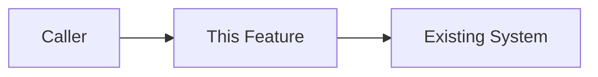
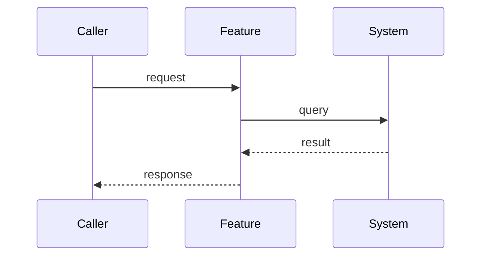

# Design: [Feature Name]

- **Spec**: NNN-<slug>
- **Status**: draft | approved
- **Requirements**: ./requirements.md (or ./bugfix.md)

## Overview

[High-level summary of the approach and how it addresses the requirements.]

### Key Design Decisions

- [Decision and its rationale.]
- [Decision and its rationale.]

## Architecture

<!-- Optional mermaid diagram of how the feature fits in. -->

## Components

<!--
Each component is a design section with a stable anchor id "### D-<Name>".
Declare which requirements it satisfies on a "satisfies:" line — tasks.md will
reference these D-<Name> anchors, and sync_check.py validates the links.
Never rename an existing D-<Name> anchor that tasks already cite.
-->

### D-[ComponentName] [Human title]

satisfies: R1, R2

**Purpose:** [What this component does.]

**Interface:**
- Input: [what it receives]
- Output: [what it produces]
- Dependencies: [what it relies on]

**Notes:** [Key implementation considerations, edge cases, error handling.]

### D-[AnotherComponent] [Human title]

satisfies: R3

**Purpose:** [What this component does.]

## Data Model / Contracts

<!-- Optional: schema changes, API contracts, message shapes. Inline only the
decision-rich parts (type shape, state machine), not a full implementation. -->

## Sequence

<!-- Optional: the important flow, as a diagram or numbered steps. -->

## Testing Strategy

- [What behavior is tested, and at which seam (prefer existing, highest seam).]
- [Prior art: similar tests in the codebase to mirror.]
